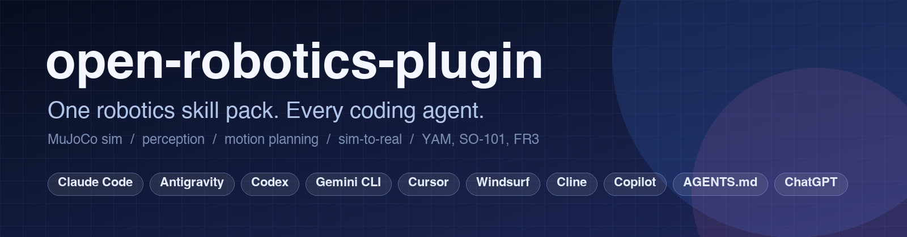
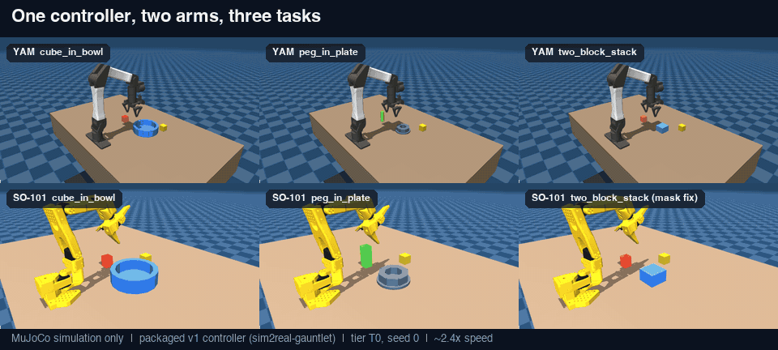
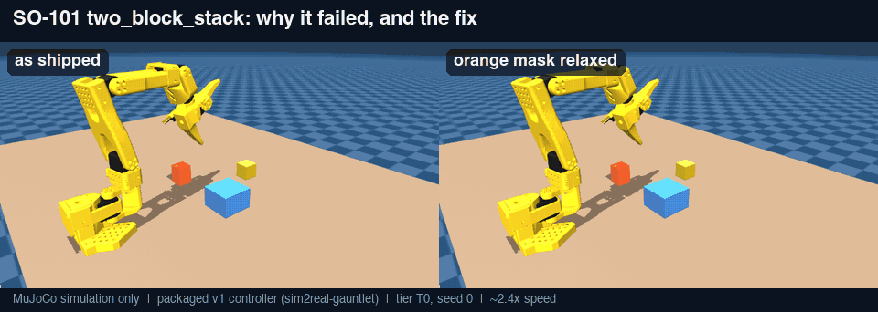

<div align="center">



<br/>

[](https://github.com/eust-w/open-robotics-plugin/actions/workflows/ci.yml)
[](LICENSE)
[](tools/orp.py)
[](#whats-inside)
[](#works-with)
[](#showcase)

**Teach any coding agent to do robotics.** MuJoCo simulation, perception, motion planning,
sim-to-real checks and robot bring-up, installed into the agent you already use with one command.

[Quick start](#quick-start) · [Works with](#works-with) · [Showcase](#showcase) · [What's inside](#whats-inside) · [Safety](#real-robot-safety) · [中文](docs/README.zh-CN.md)

<br/>



<sub>MuJoCo simulation, packaged example controller, one episode per panel at about 2.4x speed. Nothing here ran on a real robot.</sub>

</div>

---

## Why this exists

Google DeepMind published a strong set of robotics skills for Antigravity
([robotics-antigravity-plugin](https://github.com/google-deepmind/robotics-antigravity-plugin),
Apache-2.0). The skills are plain `SKILL.md` folders plus Python, so they are not
really tied to one tool. This project is the adapter layer that was missing:

- **One source, ten targets.** The same skills land in Claude Code, Codex, Gemini CLI, Cursor, Windsurf, Cline, Copilot, anything that reads `AGENTS.md`, Antigravity itself, and a ChatGPT bundle.
- **Safe by default.** The real-robot safety rule travels with every install, and uninstall removes exactly what was added.
- **Tested, with receipts.** Skills were run end to end in simulation; failures were traced to root causes and sent upstream. See [Showcase](#showcase).

> Community project, **not affiliated with Google or Google DeepMind**. Skill content is
> adapted from upstream; see [NOTICE](NOTICE).

## Quick start

```bash
git clone https://github.com/eust-w/open-robotics-plugin
cd open-robotics-plugin
python3 tools/orp.py list                                            # what is available
python3 tools/orp.py install --target claude --scope user --dry-run  # preview, writes nothing
python3 tools/orp.py install --target claude --scope user            # do it
```

Start a new agent session afterwards. Swap `claude` for any target below. Python 3.9+,
standard library only. Undo with the same flags and `uninstall`.

Options: `--scope user|project` (default `project`), `--dest DIR`, `--skills a,b,c`, `--dry-run`.

## Works with

| Harness | `--target` | How it is installed | Verification status |
|---|---|---|---|
| **Claude Code** | `claude` | native `SKILL.md` folders + safety block in `CLAUDE.md` | installed and loaded in a live session; two skills run end to end |
| **Google Antigravity** | `antigravity` | upstream plugin layout incl. MuJoCo Studio sidecar | layout matches upstream; not run inside Antigravity |
| **OpenAI Codex CLI** | `codex` | skills dir + `AGENTS.md` block | installer-tested only; paths are best effort |
| **Gemini CLI** | `gemini` | skills dir + `GEMINI.md` block | installer-tested only; paths are best effort |
| **Any `AGENTS.md` reader** (opencode, Zed, ...) | `agents-md` | `orp/` folder + index block | installer-tested only |
| **Cursor** | `cursor` | `.cursor/rules/orp-*.mdc` + `orp/` | installer-tested only |
| **Windsurf** | `windsurf` | `.windsurf/rules/orp-*.md` + `orp/` | installer-tested only |
| **Cline / Roo** | `cline` | `.clinerules/orp-robotics.md` + `orp/` | installer-tested only |
| **GitHub Copilot** | `copilot` | `.github/copilot-instructions.md` block + `orp/` | installer-tested only |
| **ChatGPT** | `chatgpt` | `dist/chatgpt/` bundle, upload by hand | simulation and code only, no hardware access |

"Installer-tested" means the files are generated correctly and links resolve (8 automated
tests, run in CI), **not** that I opened that product and confirmed it behaves. Where a path
is a best guess, override it with `--dest` and see [docs/harnesses.md](docs/harnesses.md).
Corrections via issues are very welcome.

Every install records `.orp-manifest.json`; edits to shared files (`CLAUDE.md`, `AGENTS.md`, ...)
are confined to a marked `BEGIN/END open-robotics-plugin` block, so your own text is untouched.

## Showcase

All clips are **MuJoCo simulation**, driven by the example tasks and controller shipped with the
upstream `sim2real-gauntlet` skill, after installing it into a non-Antigravity harness with this repo.

| Arm | Task | v1 controller, 20 paired episodes (tiers T0-T4) | v0 baseline |
|---|---|---|---|
| YAM | cube_in_bowl | 18 / 20 | 0 / 20 |
| YAM | peg_in_plate | 17 / 20 | 0 / 20 |
| YAM | two_block_stack | 16 / 20 | 0 / 20 |
| SO-101 | cube_in_bowl | 18 / 20 | 15 / 20 |
| SO-101 | peg_in_plate | 16 / 20 | 0 / 20 |
| SO-101 | two_block_stack | **2 / 20** | 0 / 20 |

Four episodes per tier is a smoke test, so single cells are noisy. T4 injects camera and gripper
faults, where aborting is the correct outcome: counted as safe, not as a success. Safety violations,
the paired statistics and the install workaround are in the
[run record](examples/sim2real-gauntlet-run/RUN_RECORD.md).

### The failure that became a fix

SO-101 `two_block_stack` is the weak cell. Tracing it showed the controller's orange colour test
rejects the over-exposed top face of the block, so it aims about 15 mm off-centre and the jaw hits
the edge. Relaxing that one test in-process (installed skill untouched) lifted a small test from
**1/8 to 7/8**. Left: as shipped. Right: with the fix.

<div align="center">

</div>

Full write-up with evidence and caveats: [diagnosis](examples/so101-two-block-stack-diagnosis/DIAGNOSIS.md).

<details>
<summary><b>More clips: each arm on its own</b></summary>
<br/>
<div align="center">

<br/><br/>

</div>
<br/>
MP4 versions are in <a href="showcase/media/">showcase/media</a>.
</details>

### Findings sent upstream

| | What | Status |
|---|---|---|
| [issue #11](https://github.com/google-deepmind/robotics-antigravity-plugin/issues/11) | orange colour mask rejects over-exposed block tops | open |
| [issue #12](https://github.com/google-deepmind/robotics-antigravity-plugin/issues/12) | `sim2real-gauntlet` dependencies do not resolve; README mentions missing `tests/` | open |
| [PR #13](https://github.com/google-deepmind/robotics-antigravity-plugin/pull/13) | `mujoco-audit` warns on physically impossible density | open |
| [PR #14](https://github.com/google-deepmind/robotics-antigravity-plugin/pull/14) | harness-neutral wording in `mujoco-audit` | open |

Upstream states it is not accepting external pull requests, so the PRs are offered as reference patches.

## What's inside

19 skills. Items marked ⚠ command real hardware.

| Area | Skills |
|---|---|
| **Perception** | `rgb-object-localization` · `visual-servoing` ⚠ · `workspace-calibration` ⚠ |
| **Planning and manipulation** | `motion-planning` · `pick-and-place` ⚠ · `i2rt-yam-ik` · `iteration` ⚠ |
| **Simulation and sim-to-real** | `mujoco-playground` · `mujoco-playground-rl` · `sim2real-gauntlet` · `sim2real-iteration` · `mujoco-studio-sidecar` |
| **Robot bring-up** | `so101-bringup` ⚠ · `i2rt-yam-bringup` ⚠ · `fr3-duo-control` ⚠ |
| **Assets and auditing** | `blender-creation` · `mujoco-audit` · `mujoco-showcase-shot` |
| **Sharing** | `share-example` |

Each skill is a `SKILL.md` with a trigger description plus bundled scripts, so the agent loads one
only when your task matches it.

## Real-robot safety

> [!WARNING]
> A moving robot can injure people and damage equipment. Stay next to the robot, keep the
> workspace clear and keep a way to cut power within reach. You are responsible for safe operation.

Every target installs `rules/physical_robot_safety.md` and injects a short "read this before moving
hardware" instruction. Start with `--dry-run` scripts and simulation before touching a real arm.

## Limits you should know

- **ChatGPT cannot reach USB or serial hardware.** Its bundle is for simulation, planning, code review and scripts you run locally.
- Skills that call Gemini perception models need `GEMINI_API_KEY`, in every harness. Using another vision model means editing those scripts.
- The MuJoCo Studio sidecar is an Antigravity side panel and is only installed for `--target antigravity`. Elsewhere run `skills/mujoco-studio-sidecar/scripts/studiod.py` and open the local URL it prints. `sidecar://` links in skill text only resolve in Antigravity.
- The seven MuJoCo API skills (`mujoco-python`, ...) are not included; install them from [google-deepmind/mujoco](https://github.com/google-deepmind/mujoco/tree/main/doc/skills).
- Running `sim2real-gauntlet` needs extra setup because its own dependency list does not resolve; the working recipe is in the [run record](examples/sim2real-gauntlet-run/RUN_RECORD.md).

## Roadmap

- [x] Installer for 10 targets with exact uninstall and CI
- [x] Simulation runs for `mujoco-audit` and `sim2real-gauntlet` on YAM and SO-101, with records
- [x] Root-cause analysis of the weakest case, sent upstream
- [ ] Confirm Codex, Gemini CLI, Cursor, Windsurf, Cline and Copilot paths in the real products
- [ ] A one-command upstream sync that keeps `skills/` byte-identical
- [ ] Real-robot demo footage (needs hardware; contributions welcome)

## Contributing

Issues and PRs are welcome here, especially **verified install paths for a harness you use**
([docs/harnesses.md](docs/harnesses.md) explains how to add one). Skill content under `skills/`,
`rules/` and `sidecars/` mirrors upstream and changes by re-syncing from it.

```bash
python3 -I tests/test_orp.py
```

If this saves you time, a ⭐ helps other people find it.

## Credits and license

Skills, rules and sidecar: Google LLC and DeepMind Technologies Limited, Apache-2.0, from
[robotics-antigravity-plugin](https://github.com/google-deepmind/robotics-antigravity-plugin)
v0.1.13 (commit `0f640d8`). Installer, tests, docs and showcase: this repository, Apache-2.0.
Robot models used in the clips are fetched at run time from MuJoCo Menagerie under their own
licences and are not stored here. See [NOTICE](NOTICE) and [LICENSE](LICENSE).
