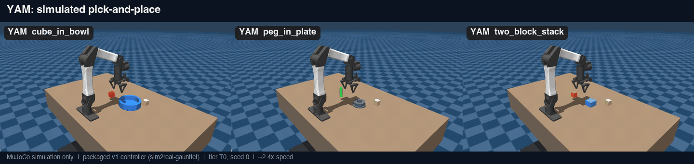
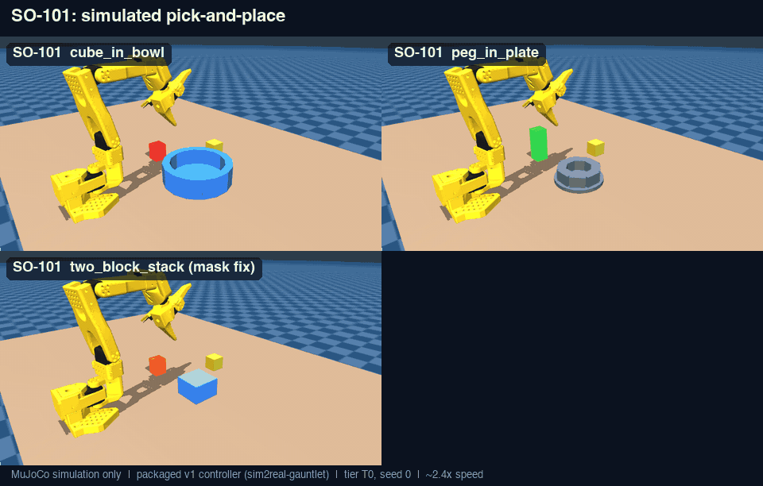

# open-robotics-plugin

Robotics agent skills (MuJoCo simulation, perception, motion planning,
sim-to-real, robot bring-up) that install into **many agent harnesses**, not
just one. The skills are community-adapted from Google DeepMind's
[robotics-antigravity-plugin](https://github.com/google-deepmind/robotics-antigravity-plugin)
(Apache-2.0). See [NOTICE](NOTICE). Not affiliated with Google.

中文简介见 [docs/README.zh-CN.md](docs/README.zh-CN.md)。

<p align="center">
  
</p>

## Showcase

Everything below is **MuJoCo simulation**, driven by the packaged example tasks and
example controller from the upstream `sim2real-gauntlet` skill, installed into a
non-Antigravity harness with this repo. Nothing here ran on a real robot.
Each clip is one episode (nominal tier T0, seed 0) at about 2.4x speed.
[MP4 versions](showcase/media/) are next to the GIFs.

| Arm | Task | Success over 20 paired episodes (T0-T4), packaged v1 controller | v0 baseline |
|---|---|---|---|
| YAM | cube_in_bowl | 18 / 20 | 0 / 20 |
| YAM | peg_in_plate | 17 / 20 | 0 / 20 |
| YAM | two_block_stack | 16 / 20 | 0 / 20 |
| SO-101 | cube_in_bowl | 18 / 20 | 15 / 20 |
| SO-101 | peg_in_plate | 16 / 20 | 0 / 20 |
| SO-101 | two_block_stack | **2 / 20** | 0 / 20 |

Four episodes per tier is a smoke test, so single cells are noisy. T4 injects camera
and gripper faults, where aborting is the correct outcome and is counted as safe but
not as a success. Full tables, safety violations and the dependency workaround are in
[the run record](examples/sim2real-gauntlet-run/RUN_RECORD.md).

### The failure that turned into a fix

SO-101 `two_block_stack` is the weak cell above. Tracing it showed the controller's
orange colour test rejects the over-exposed top face of the block, so it aimed about
15 mm off-centre and the jaw hit the block's edge. Relaxing that one test in-process
(the installed skill is untouched) took a small test from 1/8 to 7/8 episodes. Left is
as shipped, right is with the fix; see [the diagnosis](examples/so101-two-block-stack-diagnosis/DIAGNOSIS.md).

<p align="center">
  
</p>

### Per arm

<p align="center">
  
</p>
<p align="center">
  
</p>

### Regenerate the clips

`showcase/render_clip.py` runs an episode in-process and renders a free camera view
of the simulator; `showcase/build_media.py` labels and encodes the clips (needs
Pillow and ffmpeg). The environment setup is the hard part: see the install notes in
the run record. The robot models are fetched at run time from MuJoCo Menagerie under
their own licences.

## Quick start

```bash
git clone https://github.com/eust-w/open-robotics-plugin
cd open-robotics-plugin
python3 tools/orp.py list
python3 tools/orp.py install --target claude --scope user --dry-run   # preview
python3 tools/orp.py install --target claude --scope user
```

Start a new agent session afterwards. Remove with the same flags and `uninstall`.
Python 3.9+, standard library only.

## Targets

| `--target` | Harness | What it writes | Status |
|---|---|---|---|
| `claude` | Claude Code | `skills/<name>/` + safety block in `CLAUDE.md` | native SKILL.md |
| `antigravity` | Google Antigravity | upstream plugin layout incl. sidecar | upstream layout |
| `codex` | OpenAI Codex CLI | skills dir + `AGENTS.md` block | paths best-effort, override with `--dest` |
| `gemini` | Gemini CLI | skills dir + `GEMINI.md` block | paths best-effort, override with `--dest` |
| `agents-md` | opencode, Zed, any AGENTS.md reader | `orp/` + index block in `AGENTS.md` | generic fallback |
| `cursor` | Cursor | `.cursor/rules/orp-*.mdc` + `orp/` | rule + pointer |
| `windsurf` | Windsurf | `.windsurf/rules/orp-*.md` + `orp/` | rule + pointer |
| `cline` | Cline / Roo | `.clinerules/orp-robotics.md` + `orp/` | index |
| `copilot` | GitHub Copilot | `.github/copilot-instructions.md` block + `orp/` | index |
| `chatgpt` | ChatGPT Custom GPT / Project | `dist/chatgpt/` bundle, upload by hand | simulation and code only |

"Best-effort" means the destination follows my understanding of the harness
convention and has **not** been verified against every version. Use `--dest`
and see [docs/harnesses.md](docs/harnesses.md). Issues with corrections welcome.

Options: `--scope user|project` (default `project`), `--dest DIR`,
`--skills a,b,c`, `--dry-run`. Every install records `.orp-manifest.json`;
edits to shared files (`CLAUDE.md`, `AGENTS.md`, ...) are limited to a marked
`BEGIN/END open-robotics-plugin` block, so uninstall is exact.

## Real-robot safety

Hardware skills (`so101-bringup`, `i2rt-yam-bringup`, `fr3-duo-control`,
`pick-and-place`, `visual-servoing`, `workspace-calibration`, `iteration`)
move physical robots. Every target installs `rules/physical_robot_safety.md`
and injects a short "read this before moving hardware" instruction. Stay next
to the robot with a power cut within reach. You are responsible for safe
operation. Try `--dry-run` scripts and MuJoCo simulation first.

## Limits you should know

- **ChatGPT cannot reach USB/serial hardware.** The bundle is for simulation,
  planning, code review and generating scripts you run locally.
- Skills that call Gemini perception models need `GEMINI_API_KEY`, whatever
  harness you use. Swapping in another vision model means editing those scripts.
- The MuJoCo Studio sidecar (`sidecars/`) is an Antigravity side panel and is
  only installed for `--target antigravity`. Elsewhere, run
  `skills/mujoco-studio-sidecar/scripts/studiod.py` directly and open its
  printed local URL. `sidecar://` links in skill text only resolve in Antigravity.
- The seven MuJoCo API skills (`mujoco-python`, ...) are not included here;
  install them from [google-deepmind/mujoco](https://github.com/google-deepmind/mujoco/tree/main/doc/skills).

## Development

```bash
python3 -I tests/test_orp.py
```

`skills/`, `rules/`, `sidecars/` mirror upstream and should only change by
re-syncing from it (update the commit in NOTICE). Adapter logic lives in
`tools/orp.py`.
